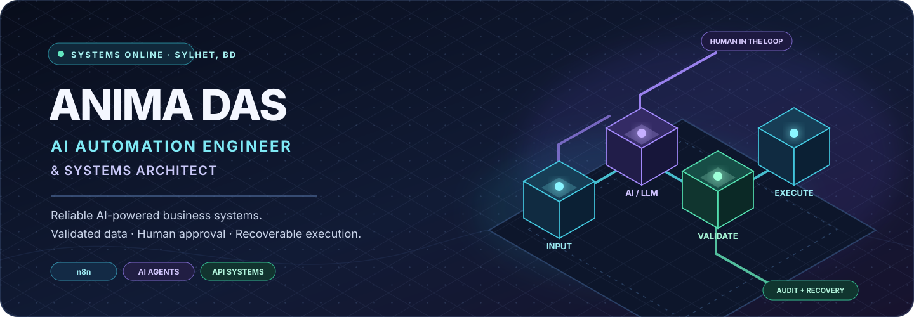
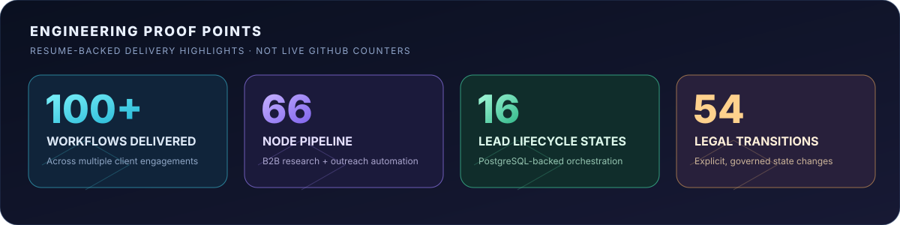
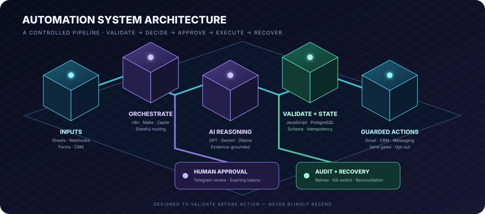
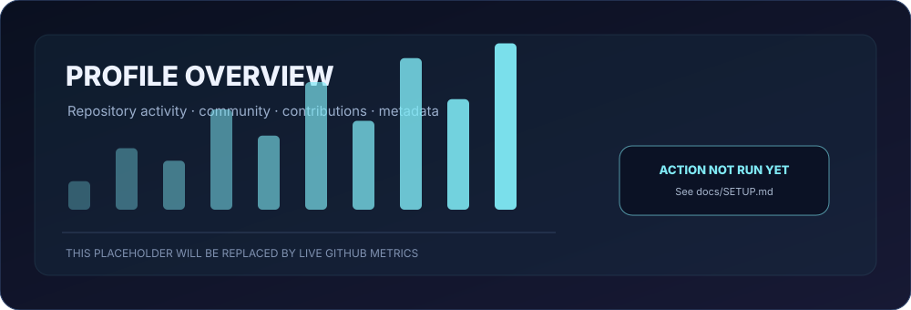
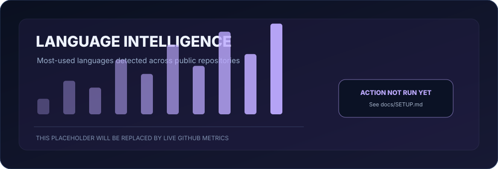
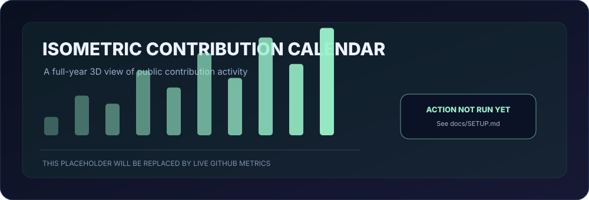
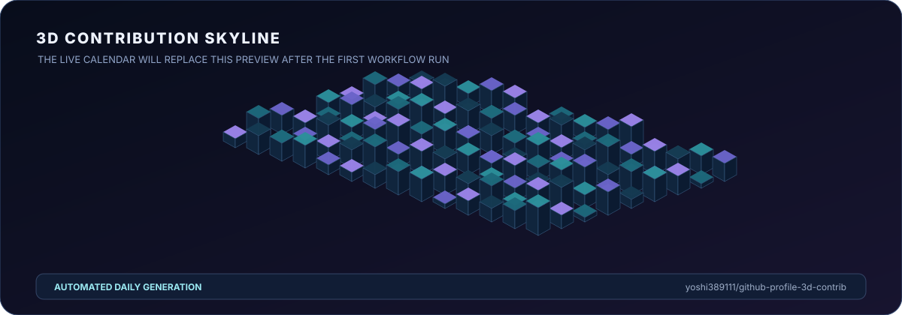
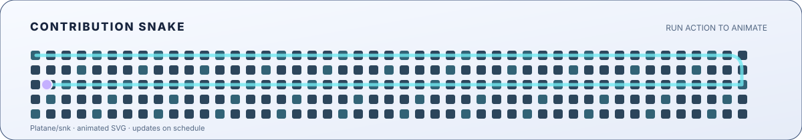

📍 Sylhet, Bangladesh &nbsp;·&nbsp; 🌍 Open to full-time remote roles &nbsp;·&nbsp; Building since 2022

---

## ◈ SYSTEM PROFILE

I am an **AI Automation Engineer & Systems Architect** who turns repetitive manual work into reliable, AI-powered business systems. I have designed, built, tested and delivered **100+ automation workflows** for multiple clients using **n8n, Make.com and Zapier**.

My work spans B2B lead research and outreach, customer support and voice agents, CRM operations, and AI-assisted business processes. I connect LLMs, APIs, webhooks, messaging, email, spreadsheets and databases — with **data validation, explicit state, idempotency, human approval and recoverable failure paths** built into the system.

> **Engineering principle:** Validate before action. Keep consequential decisions reviewable. Make failures visible, recoverable and safe to retry.

## ◈ ENGINEERING PROOF POINTS

These figures describe delivered systems and documented engineering work. They are not live GitHub activity counters.

## ◈ SELECTED AUTOMATION SYSTEMS

<table>
<tr>
<td width="50%" valign="top">

### 01 · B2B Lead Research & Cold Outreach

<b>66-NODE N8N PIPELINE</b>

Google Sheets intake and email checks flow into multi-source company research and Gemini analysis. Evidence-based drafts move through Telegram human approval using single-use, expiring tokens before a guarded Gmail send. Includes one controlled follow-up plus reply and opt-out handling.

`n8n` `Google Gemini` `Telegram HITL` `Gmail API` `Google Sheets`

</td>
<td width="50%" valign="top">

### 02 · Outreach Intelligence & Campaign Orchestrator

<b>40-NODE STATEFUL SYSTEM</b>

PostgreSQL-backed lifecycle management across **16 lead states and 54 legal transitions**. Evidence-aware drafting, claim verification, human review, layered send gates, idempotency and audit events protect each action. Uncertain outcomes are held for reconciliation — never blindly resent.

`n8n` `PostgreSQL` `JavaScript` `REST APIs`

</td>
</tr>
<tr>
<td width="50%" valign="top">

### 03 · AI Customer Support & Voice Agent

<b>40-NODE WEBHOOK BACKEND</b>

Normalizes voice-agent payloads and routes five support actions: FAQ, order status, booking, ticketing and human escalation. HMAC-SHA256 checks, PostgreSQL idempotency and fingerprinting prevent duplicate or unverified actions.

`n8n` `PostgreSQL` `Webhooks` `HMAC-SHA256`

</td>
<td width="50%" valign="top">

### 04 · Social Media & Brand Reputation Defense

<b>36-NODE EVENT-DRIVEN ENGINE</b>

Four webhook entry points with signature validation, replay protection and tenant-scoped policies. Deterministic fallback, kill switch, idempotent actions, durable human-review tasks and PostgreSQL audit records keep execution controlled and traceable.

`n8n` `PostgreSQL` `Event Processing` `Policy Controls`

</td>
</tr>
</table>

<b>More systems built</b> — click to expand

- Generative AI video pipeline using VEO 3, publishing to TikTok, Instagram and YouTube.
- Facebook Messenger support and lead-generation bot with OpenAI and human handoff.
- Local lead intelligence using Serper Maps and Ollama.

## ◈ HOW I ENGINEER RELIABLE AUTOMATION

| Engineering layer | Implementation focus |
|:--|:--|
| **AI & agent engineering** | Prompt design, schema-validated JSON, evidence-grounded generation, claim verification, confidence scoring and bounded agent execution |
| **Process orchestration** | Multi-branch workflows, stateful routing, API/webhook integrations, voice/chat intent routing and human handoff |
| **Data integrity** | Validation, normalization, idempotency keys, explicit lifecycle states and duplicate prevention |
| **Security controls** | HMAC-SHA256 verification, replay protection, tenant-scoped policies, approval gates and credential-free exports |
| **Recoverability** | Deterministic fallbacks, controlled retries, explicit error paths, audit logs and reconciliation |

## ◈ TECHNOLOGY CONSTELLATION

**AI · LLM · AGENTS**

**AUTOMATION · ORCHESTRATION**

**DEVELOPMENT · DATA · INTEGRATION**

**BUSINESS SYSTEMS · CONNECTORS**

## ◈ LIVE GITHUB INTELLIGENCE

The cards below are generated from GitHub data by **lowlighter/metrics**. They become live after the optional Metrics workflow is configured. Until then, the included artwork is a setup placeholder.

<table>
<tr>
<td width="50%" valign="top"></td>
<td width="50%" valign="top"></td>
</tr>
<tr>
<td colspan="2" valign="top"></td>
</tr>
</table>

## ◈ 3D CONTRIBUTION UNIVERSE

This is a 3D isometric preview. After you add and run the optional 3D Contribution Calendar workflow, it is replaced with your real GitHub contribution calendar.

  

<b>Contribution Snake · animated activity trail</b>

  <picture>
    <source media="(prefers-color-scheme: dark)" srcset="./github-snake-dark.svg" />
    <source media="(prefers-color-scheme: light)" srcset="./github-snake.svg" />
    
  </picture>

## ◈ PROFESSIONAL JOURNEY

**AI Automation Engineer & Systems Architect** · *Independent Remote Consultant*  
**2022 — Present**

- Designed, built, tested and delivered 100+ workflows for multiple clients across n8n, Make.com and Zapier.
- Automated lead research, outreach, customer support and operations, placing human approval around consequential decisions.
- Engineered multi-branch, stateful systems with JavaScript, JSON transformation, PostgreSQL-backed state and explicit error paths; larger workflows span 36–66 nodes.
- Integrated AI providers, Gmail, Telegram, Google Sheets, ZeroBounce, HubSpot, GoHighLevel and PostgreSQL through APIs and webhooks.
- Delivered credential-free exports with setup documentation, placeholders, test scenarios and maintenance notes.

**Education**  
B.Sc. in Computer Science & Engineering · Shahjalal University of Science and Technology (SUST)

## ◈ CURRENT FOCUS

- Advanced n8n architecture, persistent state and multi-agent workflows.
- Evidence-grounded AI outputs, confidence checks and human-in-the-loop execution.
- Secure API orchestration with replay protection, idempotency and auditability.
- Recoverable automation systems with explicit failure paths and safe reconciliation.

## ◈ LET'S CONNECT

I am open to **full-time remote opportunities** in AI automation, workflow engineering, AI agents, business process automation and API integration.

ANIMA DAS · AI AUTOMATION ENGINEER & SYSTEMS ARCHITECT

