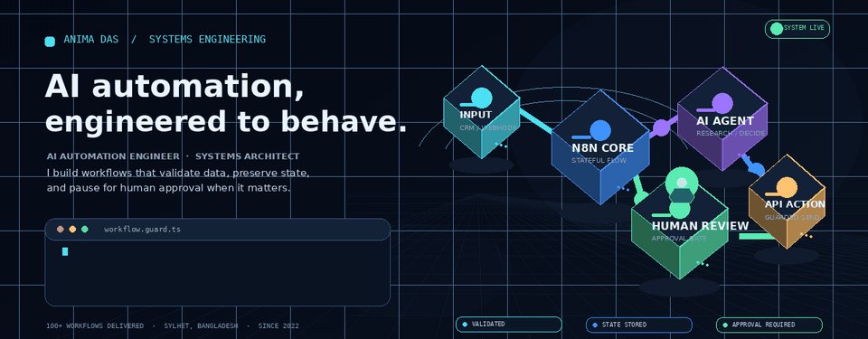
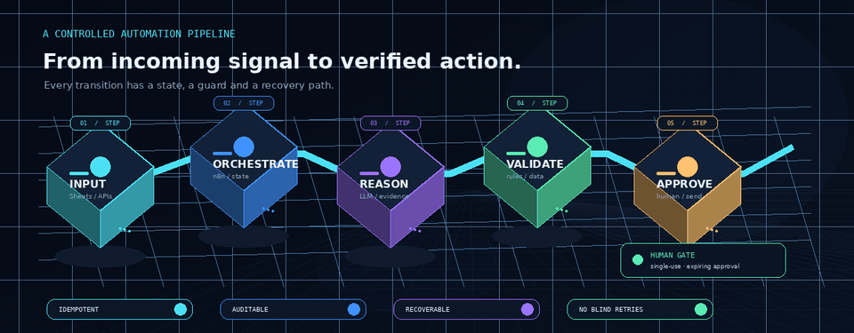
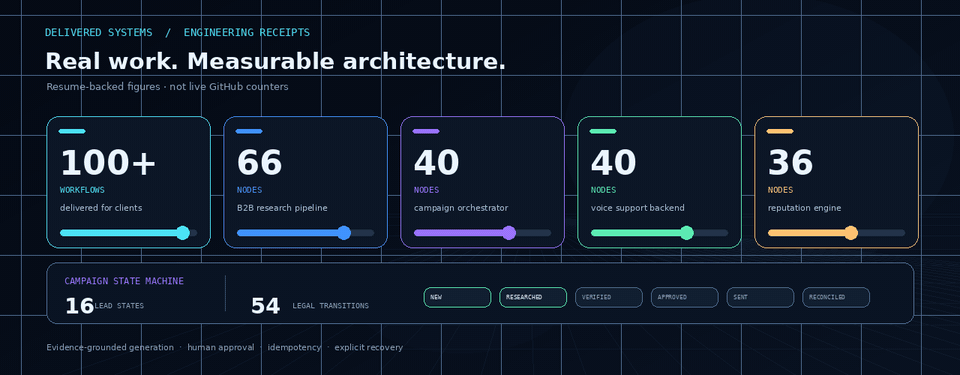

**AI Automation Engineer & Systems Architect**  
Sylhet, Bangladesh · Open to full-time remote roles

---

## What I build

I design and deliver business automation that is reliable after it goes live — not just workflows that work once in a demo.

My work combines **n8n, AI agents, APIs, PostgreSQL and business systems** to automate lead research, outreach, customer support and operations. I build in validation, explicit state, duplicate protection and human approval where an automated action carries risk.

**100+ workflows designed, built, tested and delivered for multiple clients** across n8n, Make.com and Zapier.

## Engineering, in motion

## Selected systems

| System | What it does |
|:--|:--|
| **B2B lead research & cold outreach** · 66 nodes | Collects leads, verifies contact data, researches companies across sources, drafts evidence-based outreach and sends only after Telegram approval. Includes controlled follow-up and reply/opt-out handling. |
| **Outreach intelligence & campaign orchestrator** · 40 nodes | PostgreSQL-backed lifecycle across **16 lead states and 54 permitted transitions**. Uses claim checks, human review, idempotency, audit events and reconciliation for uncertain outcomes. |
| **AI customer support & voice agent** · 40 nodes | Normalizes voice-agent requests and routes FAQ, order status, booking, ticketing or human escalation. Uses HMAC-SHA256 verification and duplicate-action protection. |
| **Social media & brand reputation defense** · 36 nodes | Processes four webhook entry points with signature checks, replay protection, tenant policies, a kill switch, human-review tasks and audit records. |

## Delivery record

These are figures from my documented project work and résumé — not live GitHub statistics.

## Tools I work with

**AI & agents**  

**Automation & integrations**  

**Code & data**  

**Business systems**  

## How I engineer

- **Validate before action:** normalize and verify inputs before a workflow proceeds.
- **Preserve state:** make lifecycle transitions explicit and enforce permitted paths.
- **Prevent duplicates:** use idempotency and fingerprints around consequential actions.
- **Keep humans in control:** pause for approval when the action needs judgment.
- **Recover deliberately:** use deterministic fallbacks, controlled retries, audit logs and reconciliation.

## Experience

**AI Automation Engineer & Systems Architect** · Independent remote consultant  
**2022 — Present**

Designed, tested and delivered 100+ client workflows; integrated AI services, Gmail, Telegram, Google Sheets, CRM platforms and PostgreSQL through APIs and webhooks. Larger systems in my project record span 36–66 nodes. Client handovers include credential-free exports, setup notes, test scenarios and maintenance guidance.

**B.Sc. in Computer Science & Engineering**  
Shahjalal University of Science and Technology (SUST)

---

**Interested in reliable AI automation, n8n engineering or systems integration?**  
[Connect on LinkedIn](https://www.linkedin.com/in/anima-das-automation) · [View my portfolio](https://anima-das-website.vercel.app) · [Email me](mailto:anima.das2k0@gmail.com)

ANIMA DAS · Build deliberately. Validate everything. Recover cleanly.

