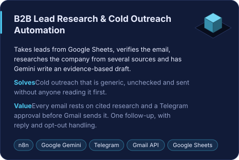
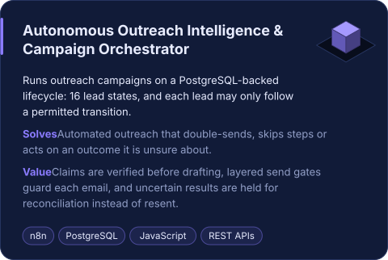
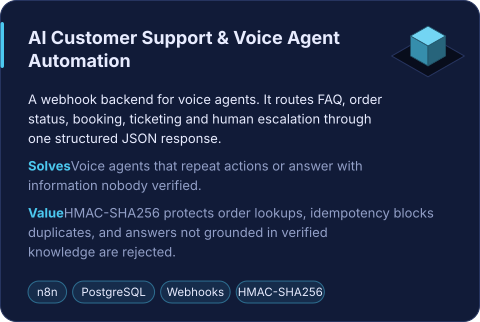
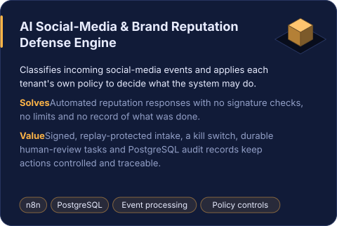
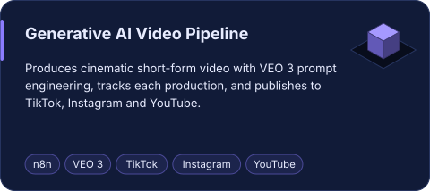
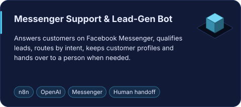
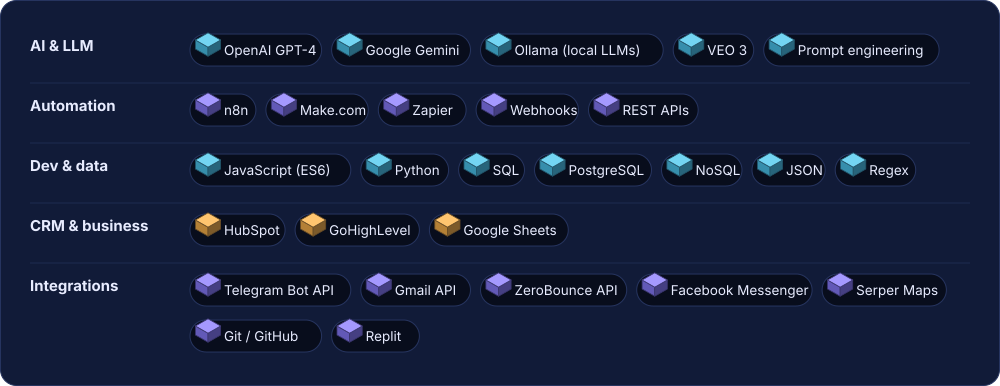
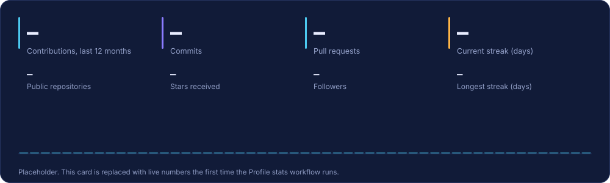

  

Flat-upload edition: all supplied assets sit in this repository root. Files beginning with <code>workflow__</code> are setup templates; GitHub Actions only runs workflow files placed under <code>.github/workflows/</code>.

<table>
  <tr>
    <td width="170" align="center" valign="top">
      
    </td>
    <td valign="top">
      
I build business automation that is safe to leave running. Most of it is on <b>n8n</b>, with <b>Make.com</b> and <b>Zapier</b> where they fit. The work covers lead research, outreach and customer support: AI steps inside workflows that check data first, ask a person before anything consequential happens, and keep a record of what they did.

      
Since 2022 I have delivered 100+ automation workflows for clients. Each one is handed over with documented setup, test scenarios and maintenance notes, and with credentials kept out of the export.

    </td>
  </tr>
</table>

  
  
  
  

## How my workflows run

The same shape sits under every project below. Data enters through one defined door and is validated before anything uses it. A model decides only inside a structure I define, and a person approves anything consequential. Actions are idempotent, so a retry never repeats them, and state and audit events are written down so a failure stays visible.

## Featured projects

<table>
  <tr>
    <td width="50%" valign="top">
      
    </td>
    <td width="50%" valign="top">
      
    </td>
  </tr>
  <tr>
    <td width="50%" valign="top">
      
    </td>
    <td width="50%" valign="top">
      
    </td>
  </tr>
</table>

### Also built

<table>
  <tr>
    <td width="50%" valign="top">
      
    </td>
    <td width="50%" valign="top">
      
    </td>
  </tr>
</table>

I also built a local lead-intelligence workflow that finds businesses through Serper Maps and scores them with a local Ollama model.

## What I work with

## Activity

<picture>
  <source media="(prefers-color-scheme: dark)" srcset="profile-3d-contrib__profile-night-view.svg">
  <source media="(prefers-color-scheme: light)" srcset="profile-3d-contrib__profile-green-animate.svg">
  
</picture>

These 3D and stats files begin as placeholders. To enable daily updates, install the supplied <code>workflow__*.yml</code> templates at their required GitHub path: <code>.github/workflows/</code>, then enable GitHub Actions.

## Experience

**AI Automation Engineer & Systems Architect**, self-employed independent remote consultant, 2022 to present

- Designed, built, tested and delivered 100+ automation workflows for multiple clients across n8n, Make.com and Zapier.
- Automated repetitive work in lead research, outreach, customer support and operations, with human approval wherever a decision carries risk.
- Built multi-branch, stateful n8n systems with JavaScript logic, JSON transformation, PostgreSQL-backed state and explicit error paths.
- Connected AI providers, Gmail, Telegram, Google Sheets, ZeroBounce, HubSpot, GoHighLevel and PostgreSQL through APIs and webhooks.
- Handed over credential-free exports with setup notes, placeholders, test scenarios and maintenance notes.

**Education:** B.Sc. in Computer Science & Engineering, Shahjalal University of Science and Technology (SUST), 2005 to 2009

