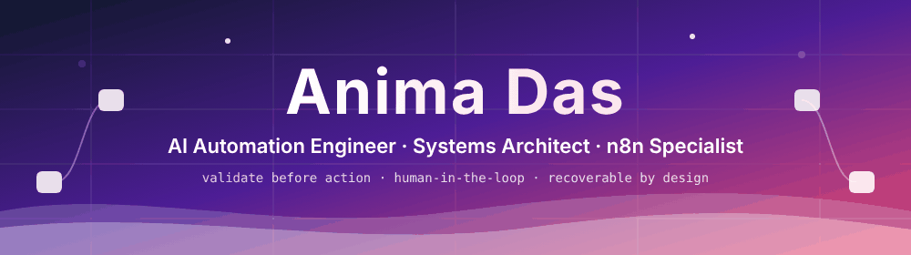
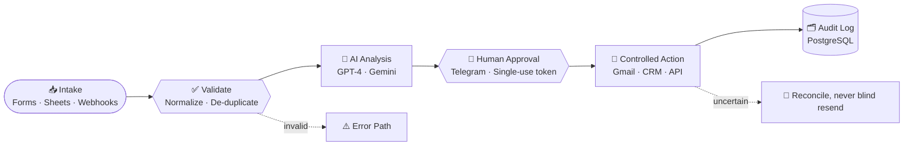

<!--
  Anima Das — AI Automation Engineer & Systems Architect (Sylhet, Bangladesh · Remote)
  n8n · Make.com · Zapier · AI Agents · OpenAI GPT-4 · Google Gemini · PostgreSQL · REST APIs · Webhooks
  Portfolio: https://anima-das-website.vercel.app
-->

<div align="center">

<a href="https://anima-das-website.vercel.app">
  
</a>


<br/>

[](https://anima-das-website.vercel.app)
[](https://www.linkedin.com/in/anima-das-automation)
[](mailto:anima.das2k0@gmail.com)
[](https://github.com/Anima-Das)

<samp>📍 Sylhet, Bangladesh &nbsp;·&nbsp; 🌍 Open to Remote &nbsp;·&nbsp; 💼 Actively seeking a full-time role</samp>

</div>

<br/>

<table>
<tr>
<td valign="top" width="68%">

## 👋 Hi, I'm Anima

I turn repetitive manual work into **reliable, AI-powered business systems**. Since 2022 I have delivered **100+ automation workflows** for multiple clients using **n8n, Make.com and Zapier**, connecting CRMs, email, messaging and APIs, with **data validation, duplicate prevention and human approval** built in.

- 🤖 AI lead research, outreach and customer-support systems
- 🛡️ Workflows that **validate before they act** and **recover when they fail**
- 👥 A **human approval gate** wherever a decision carries risk
- 📨 Clients report time savings and less repetitive manual work

</td>
<td align="center" valign="middle" width="32%">


</td>
</tr>
</table>

<div align="center">
 
</div>

---

## 🪪 Quick Facts

| | |
| :--- | :--- |
| **Role** | AI Automation Engineer & Systems Architect |
| **Experience** | Independent remote consultant since 2022 |
| **Delivered** | 100+ automation workflows for multiple clients |
| **Platforms** | n8n · Make.com · Zapier |
| **AI** | OpenAI GPT-4 · Google Gemini · Ollama (local LLMs) · VEO 3 |
| **Education** | B.Sc. in Computer Science & Engineering, SUST |
| **Looking for** | Full-time remote roles |

---

## 🎯 What I Automate

| | Area | What it covers |
| :-: | :--- | :--- |
| 📈 | **B2B lead research & outreach** | Multi-source company research, email verification, evidence-based drafts, controlled follow-up |
| 🎧 | **Customer support & voice agents** | Intent routing, FAQ, order status, booking, ticketing and human escalation |
| 🛡️ | **Brand & social-media defense** | Signed webhook intake, policy-based actions, kill switch, human review tasks |
| 🎬 | **Generative video pipelines** | VEO 3 prompt engineering and auto-publishing to TikTok, Instagram and YouTube |
| 🏢 | **CRM & operations** | HubSpot, GoHighLevel, Google Sheets, Gmail, Telegram, calendars |

---

## 🧰 Tech Stack

<table>
<tr>
<td valign="top" width="50%">

### 🧠 AI & LLM


</td>
<td valign="top" width="50%">

### ⚙️ Automation


</td>
</tr>
<tr>
<td valign="top" width="50%">

### 💻 Dev & Data
-F7DF1E?style=flat-square&logo=javascript&logoColor=black)


</td>
<td valign="top" width="50%">

### 🏢 CRM & Business Systems


</td>
</tr>
<tr>
<td valign="top" colspan="2">

### 🔌 Integrations & Tools


</td>
</tr>
</table>

<details>
<summary><b>🏗️ Core strengths</b> — <sub>click to expand</sub></summary>

<br/>

| Area | What I do |
| :--- | :--- |
| **Workflow architecture** | Multi-branch, stateful n8n systems with JavaScript logic, JSON transformation and PostgreSQL-backed state |
| **AI agents & LLM workflows** | Prompt design, schema-validated JSON output, evidence-grounded generation, claim verification, confidence scoring |
| **Business process automation** | Map repetitive work, bottlenecks and exception paths, then orchestrate APIs, webhooks, CRMs, email and calendars |
| **B2B lead research & outreach** | Multi-source research, email verification, evidence-based drafts, controlled follow-up |
| **AI voice & chat agents** | Intent routing, structured responses and human handoff |
| **Reliability** | Idempotency keys, explicit lifecycle states, deterministic fallbacks, audit logging, reconciliation of uncertain outcomes |

</details>

---

## 🚀 Featured Projects

| Project | Stack | What it does |
| :--- | :--- | :--- |
| [**B2B Lead Research & Cold Outreach Automation**](https://github.com/Anima-Das/B2B-Lead-Research-Cold-Outreach-Automation) | `n8n` `Gemini` `Telegram` `Gmail` `Sheets` | 66-node pipeline: Sheets intake and email checks, multi-source company research and Gemini analysis, evidence-based drafts. Telegram human approval (single-use, expiring tokens) and a final send gate control Gmail delivery. |
| [**Autonomous Outreach Intelligence & Campaign Orchestrator**](https://github.com/Anima-Das/autonomous-outreach-intelligence-campaign-orchestrator) | `n8n` `PostgreSQL` `JavaScript` `REST` | 40-node stateful workflow: 16 lead states and 54 legal transitions, claim verification, layered send gates, idempotency and audit events. Uncertain outcomes are held for reconciliation, never blindly resent. |
| [**AI Customer Support & Voice Agent Automation**](https://github.com/Anima-Das/AI-Customer-Support-Voice-Agent-Automation) | `n8n` `PostgreSQL` `Webhooks` `HMAC-SHA256` | 40-node webhook backend that normalizes voice-agent payloads and routes five actions (FAQ, order status, booking, ticketing, human escalation). Duplicate control and grounded-answer checks. |
| [**AI Social-Media & Brand Reputation Defense Engine**](https://github.com/Anima-Das/autonomous-ai-social-media-reputation-defense-engine) | `n8n` `PostgreSQL` `Event processing` | 36-node workflow with four webhook entry points, HMAC-SHA256 signatures, replay protection, tenant-scoped policy, kill switch and PostgreSQL audit records. |
| [**Generative AI Video Production & Publishing Pipeline**](https://github.com/Anima-Das/generative-ai-video-production-publishing-pipeline) | `n8n` `VEO 3` | Cinematic short-form video generation and automated publishing to TikTok, Instagram and YouTube. |
| [**Smart AI Customer Support & Lead Generation**](https://github.com/Anima-Das/smart-ai-customer-support-lead-generation-human-handoff) | `n8n` `OpenAI` `Messenger` | Facebook Messenger support and lead-gen bot with intent routing, persistent customer profiles and human handoff. |

---

## 🔄 How My Automations Flow



---

## 🧱 Engineering Principles

| | Principle | In practice |
| :-: | :--- | :--- |
| **01** | **Validate before action** | Validation, normalization and duplicate handling gate data before it moves downstream. |
| **02** | **Human review where it matters** | Approval gates in front of consequential actions such as outbound communication. |
| **03** | **Explicit failure paths** | Fallbacks and structured error paths so invalid data never silently continues. |
| **04** | **Preserve state, prevent duplicates** | Idempotency keys and explicit lifecycle states across multi-step systems. |
| **05** | **Recoverability** | Audit logging, controlled retries and reconciliation keep failures visible and nothing silently repeated. |
| **06** | **Secure handover** | Credential-free exports with documented setup, placeholders, test scenarios and maintenance notes. |

---

## 💼 Experience

**AI Automation Engineer & Systems Architect** · *Self-Employed / Independent Remote Consultant* · **2022 – Present**

- Designed, built, tested and delivered **100+ automation workflows** for multiple clients across n8n, Make.com and Zapier.
- Automated lead research, outreach, customer support and operations, with human approval wherever a decision carries risk.
- Built multi-branch, stateful n8n systems (36–66 nodes) with JavaScript logic, JSON transformation, PostgreSQL-backed state and explicit error paths.
- Connected AI providers, Gmail, Telegram, Google Sheets, ZeroBounce, HubSpot, GoHighLevel and PostgreSQL through APIs and webhooks.

🎓 **B.Sc. in Computer Science & Engineering** · Shahjalal University of Science and Technology (SUST) · 2005 – 2009

---

---

## 🔭 Currently

```text
> focus      Advanced n8n workflows with multi-branch logic and persistent state
> building   Autonomous AI agents with human approval checkpoints
> improving  Reliability: validation, error handling, retries, audit logging
> status     Open to full-time remote roles
```

---

## 🤝 Let's Build Something

I'm open to **full-time remote roles** where automation is treated as engineering.

<div align="center">

| | |
| :--- | :--- |
| 🌐 **Portfolio** | [anima-das-website.vercel.app](https://anima-das-website.vercel.app) |
| 💼 **LinkedIn** | [linkedin.com/in/anima-das-automation](https://www.linkedin.com/in/anima-das-automation) |
| 🐙 **GitHub** | [github.com/Anima-Das](https://github.com/Anima-Das) |
| ✉️ **Email** | [anima.das2k0@gmail.com](mailto:anima.das2k0@gmail.com) |
| 📞 **Phone** | [+880 1996 520752](tel:+8801996520752) |

<br/>

<samp><b>Automation that validates before it acts, and recovers when it fails.</b></samp>

</div>
